 

 

> 🌤️ Sou desenvolvedor e adoro transformar ideias em projetos web completos, do banco de dados até a tela  
> 🌱 Aprendo construindo: cada projeto é feito em etapas, entendendo o porquê de cada decisão  
> 💧 Curto interfaces limpinhas, brilhantes e cheias de vida (sim, saudade de 2008)  
> 🎮 Também gosto de criar jogos e experiências multiplayer  
> 📫 Fale comigo: **Tutygodoi9@gmail.com**

 

| | |
|---|---|
| 🔭 **Trabalhando em** | Um jogo de cartas multiplayer online e um e-commerce full-stack |
| 📚 **Estudando** | Next.js, TypeScript, PostgreSQL e WebSockets |
| 🎓 **TCC** | API de controle de estoque com Express |
| 🎯 **Objetivo** | Dominar o desenvolvimento full-stack, uma etapa por vez |

 

**Linguagens**  

**Front-end**  

**Back-end e dados**  

**Ferramentas e deploy**  

 

<table>
  <tr>
    <td width="33%" valign="top">
      <h3>🃏 Jogo de cartas online</h3>
      
Jogo de cartas multiplayer em tempo real, com salas e partidas ao vivo.

      
  

      
<a href="https://github.com/10Shiny01/NOME_DO_REPO">🔗 Ver projeto</a>

    </td>
    <td width="33%" valign="top">
      <h3>🛒 E-commerce full-stack</h3>
      
Loja virtual completa: catálogo, carrinho, pedidos e painel administrativo.

      
  

      
<a href="https://github.com/10Shiny01/NOME_DO_REPO">🔗 Ver projeto</a>

    </td>
    <td width="33%" valign="top">
      <h3>📦 WebExemption (TCC)</h3>
      
API de controle de estoque desenvolvida como trabalho de conclusão de curso.

      
 

      
<a href="https://github.com/10Shiny01/NOME_DO_REPO">🔗 Ver projeto</a>

    </td>
  </tr>
</table>

 

 

 

